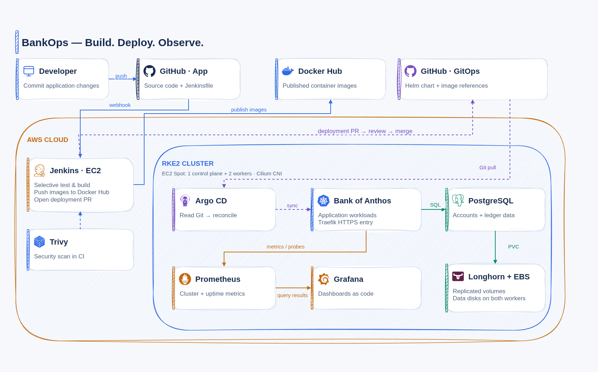

# 🏦 BankOps Platform

A hands-on DevOps platform for deploying Bank of Anthos on AWS EC2 with selective CI, GitOps delivery, persistent storage, monitoring, and HTTPS.


## 📖 Overview

BankOps is a DevOps portfolio project that follows an application from source code to a running Kubernetes deployment. It demonstrates how to build and publish container images, review deployment changes through pull requests, reconcile workloads from Git, and observe the deployed system.

The platform runs on a small, self-managed RKE2 cluster on AWS EC2: one control-plane node and two workers. Jenkins runs on a separate EC2 instance. The scope is a working lab with explicit operational limitations, rather than a claim of production readiness.

| Repository | Responsibility |
|---|---|
| **[bankops-platform](https://github.com/TUNAS106/bankops-platform)** — this repository | Application Helm chart, environment configuration, Argo CD resources, monitoring, certificates, and architecture documentation. |
| **[bankops-app](https://github.com/TUNAS106/bankops-app)** | Application source, Jenkins pipeline, selective service detection, image builds, vulnerability scanning, and deployment PR automation. |

The application is based on Google's **[Bank of Anthos](https://github.com/GoogleCloudPlatform/bank-of-anthos)** sample. This project's focus is the DevOps integration and operation of that application; the banking application is not presented as original work.

## 🏗️ System Architecture



[Open the editable Draw.io diagram](docs/architecture/bankops-architecture.drawio)

### Infrastructure

The EC2-based RKE2 cluster contains **one control plane and two workers**, using Cilium for networking and Traefik for ingress. Bank of Anthos runs as application workloads with two PostgreSQL databases. Longhorn stores volume replicas on EBS-backed worker data disks.

Argo CD, cert-manager, and the monitoring stack run inside Kubernetes. Jenkins runs separately on EC2; GitHub and Docker Hub are external services.

### CI/CD and GitOps flow

1. A developer pushes an application change to `bankops-app`; a GitHub webhook triggers Jenkins.
2. Jenkins selects affected services, runs their quality checks, builds images, and scans them with Trivy.
3. When publishing is enabled, Jenkins pushes images to Docker Hub and records their references and digests.
4. When deployment PR creation is enabled, Jenkins updates the corresponding entries in [`demo.yaml`](apps/bank-of-anthos/environments/demo.yaml) and opens a PR against `bankops-platform`.
5. A reviewer checks and merges the PR. Argo CD reads the updated configuration, renders the Helm chart, and synchronizes the application.
6. Kubernetes nodes pull the referenced images and roll out the workloads. Deployment health is checked separately from CI success.

Jenkins does not directly apply application manifests to the cluster. The GitOps repository is the source of desired application configuration.

### Application access and observability

```text
Browser → HTTPS / bankops.test → EC2 ingress entry → Traefik
        → frontend Service → application services → PostgreSQL
```

The demo hostname is resolved through a client hosts entry, and clients must trust the internal CA. TLS terminates at Traefik; backend application traffic remains HTTP.

Prometheus scrapes exporters and Blackbox probe results. Grafana queries Prometheus for dashboards. Alertmanager sends firing and resolved notifications to Slack for application HTTP unavailability, repeated container crashes, and low filesystem free space.

The Blackbox HTTPS probe reaches Traefik through its **internal Kubernetes Service**, using the application hostname for Host/SNI and validating the demo CA. It checks the frontend login endpoint, not the complete public Internet path or a banking transaction.

## ✨ Key Highlights

- **Selective CI:** Jenkins detects affected services and runs the corresponding quality checks and image builds. An explicit `FORCE_ALL` option supports a full build.
- **Container publishing:** Python services and database images use Dockerfiles; Java services use Maven/Jib. Images are published to Docker Hub with commit/build tags and recorded digests.
- **Security visibility:** Trivy scans built images and archives HIGH/CRITICAL vulnerability reports. The current policy reports vulnerabilities without blocking publication solely on severity.
- **Reviewed GitOps updates:** After publishing, Jenkins can open a pull request updating selected image references in this repository. A human reviews and merges the change.
- **Argo CD delivery:** Argo CD renders the application Helm chart and reconciles merged configuration into RKE2, with automated sync and self-healing.
- **Persistent storage:** Longhorn provides replicated volumes backed by worker EBS data disks for PostgreSQL and monitoring components.
- **Monitoring and notifications:** Prometheus collects cluster metrics and Blackbox availability checks; Grafana provisions dashboards from code; Alertmanager routes BankOps alerts to Slack.
- **HTTPS demonstration:** cert-manager issues an application certificate from an internal demo CA. Traefik terminates HTTPS for `bankops.test`.

## 📂 Repository Structure

```text
bankops-platform/
├── apps/
│   └── bank-of-anthos/
│       ├── chart/                   # Application Helm chart and templates
│       ├── environments/            # Demo values and optional overrides
│       ├── kubernetes-manifests/    # Earlier manual deployment manifests
│       ├── scripts/                 # Migration and adoption utilities
│       └── tests/                   # Helm chart checks
├── infrastructure/
│   ├── argocd/                      # Argo CD installation and GitOps resources
│   │   └── application/             # BankOps Argo CD Application
│   ├── cert-manager/                # Installation values, issuers, certificates
│   └── monitoring/                  # Prometheus stack, Blackbox, alert routing
│       ├── dashboards/              # Dashboard generator, JSON, ConfigMap
│       └── tests/                   # Alert delivery test manifests
├── local/
│   └── bank-of-anthos/              # Docker Compose practice environment
├── docs/
│   └── architecture/                # Editable diagram, exported image, assets
└── README.md
```

The active application deployment uses [`chart/`](apps/bank-of-anthos/chart) and [`environments/demo.yaml`](apps/bank-of-anthos/environments/demo.yaml), referenced by the [Argo CD Application](infrastructure/argocd/application/bankops.yaml). The manual manifests are retained as learning/reference material and should not be applied alongside the GitOps-managed application.

Infrastructure installation resources are maintained separately; the BankOps Argo CD Application does not manage every file under `infrastructure/`. Credentials and private keys are supplied outside Git.

## ⚠️ Limitations & Future Improvements

| Current limitation | Possible next improvement |
|---|---|
| One control plane; the lab is not highly available. Spot interruptions can affect availability. | Design control-plane redundancy and test node/interruption recovery. |
| AWS infrastructure is provisioned manually. | Define AWS resources with infrastructure as code and document reproducible recovery. |
| Jenkins uses a built-in execution node on its EC2 host. | Separate controller and build agents, then introduce isolated or ephemeral agents. |
| Selective CI compares against the last successful CI commit, not the last published/deployed release. | Track release state separately so skipped publishing does not leave changes behind. |
| Trivy reports CVEs but does not enforce a severity-based publication gate. | Establish a remediation baseline, controlled exceptions, and a blocking security policy. |
| Argo CD self-healing is enabled, but automatic pruning is disabled. | Introduce reviewed deletion workflows before enabling pruning. |
| HTTPS uses an internal CA and a local `.test` hostname; administrative UIs retain lab HTTP configuration. | Add managed DNS and trusted HTTPS, and restrict administrative access appropriately. |
| TLS ends at ingress; internal application traffic is not encrypted end to end. | Evaluate internal TLS according to the deployment's security requirements. |
| Longhorn replication is not a backup. EBS snapshot recovery has been manual; automated backup and tested restore objectives are not established. | Automate database/platform backups and regularly validate recovery against explicit RPO/RTO targets. |
| Monitoring focuses on infrastructure, workload state, and an internal HTTPS probe. Some control-plane monitors are disabled. | Extend monitoring coverage, add public-path and business-flow checks, and define application service objectives. |
| Centralized logs, distributed tracing, and CI smoke/end-to-end tests are not included. | Add these incrementally where they improve diagnosis and release confidence. |
| Grafana persistence is disabled; provisioned dashboards are maintained in Git. | Keep configuration reproducible and persist any additional state that must survive replacement. |

These limitations describe the current lab scope. Future improvements are planned directions, not implemented capabilities.
